# Projects and dependencies analysis

This document provides a comprehensive overview of the projects and their dependencies in the context of upgrading to .NETCoreApp,Version=v10.0.

## Table of Contents

- [Executive Summary](#executive-Summary)
  - [Highlevel Metrics](#highlevel-metrics)
  - [Projects Compatibility](#projects-compatibility)
  - [Package Compatibility](#package-compatibility)
  - [API Compatibility](#api-compatibility)
  - [Binding Redirect Configuration](#binding-redirect-configuration)
- [Aggregate NuGet packages details](#aggregate-nuget-packages-details)
- [Top API Migration Challenges](#top-api-migration-challenges)
  - [Technologies and Features](#technologies-and-features)
  - [Most Frequent API Issues](#most-frequent-api-issues)
- [Projects Relationship Graph](#projects-relationship-graph)
- [Project Details](#project-details)

  - [Sem.Data.SprocAccess.FileSystem\Sem.Data.SprocAccess.FileSystem.csproj](#semdatasprocaccessfilesystemsemdatasprocaccessfilesystemcsproj)
  - [Sem.Data.SprocAccess.FileSystemTests\Sem.Data.SprocAccess.FileSystemTests.csproj](#semdatasprocaccessfilesystemtestssemdatasprocaccessfilesystemtestscsproj)
  - [Sem.Data.SprocAccess.IntegrationTests\Sem.Data.SprocAccess.IntegrationTests.csproj](#semdatasprocaccessintegrationtestssemdatasprocaccessintegrationtestscsproj)
  - [Sem.Data.SprocAccess.MicrosoftSqlServer\Sem.Data.SprocAccess.MicrosoftSqlServer.csproj](#semdatasprocaccessmicrosoftsqlserversemdatasprocaccessmicrosoftsqlservercsproj)
  - [Sem.Data.SprocAccess.SqlServer\Sem.Data.SprocAccess.SqlServer.csproj](#semdatasprocaccesssqlserversemdatasprocaccesssqlservercsproj)
  - [Sem.Data.SprocAccess\Sem.Data.SprocAccess.csproj](#semdatasprocaccesssemdatasprocaccesscsproj)
  - [Sem.MdDocGenerator\Sem.MdDocGenerator.csproj](#semmddocgeneratorsemmddocgeneratorcsproj)
  - [Sem.Tools.CmdLine.TestProject\Sem.Tools.CmdLine.TestProject.csproj](#semtoolscmdlinetestprojectsemtoolscmdlinetestprojectcsproj)
  - [Sem.Tools.CmdLine.Tests\Sem.Tools.CmdLine.Tests.csproj](#semtoolscmdlinetestssemtoolscmdlinetestscsproj)
  - [Sem.Tools.CmdLine\Sem.Tools.CmdLine.csproj](#semtoolscmdlinesemtoolscmdlinecsproj)
  - [Sem.Tools.Logging.Tests\Sem.Tools.Logging.Tests.csproj](#semtoolsloggingtestssemtoolsloggingtestscsproj)
  - [Sem.Tools.Logging\Sem.Tools.Logging.csproj](#semtoolsloggingsemtoolsloggingcsproj)
  - [Sem.Tools.TestHelper.Tests\Sem.Tools.TestHelper.Tests.csproj](#semtoolstesthelpertestssemtoolstesthelpertestscsproj)
  - [Sem.Tools.TestHelper\Sem.Tools.TestHelper.csproj](#semtoolstesthelpersemtoolstesthelpercsproj)
  - [Sem.Tools.Tests\Sem.Tools.Tests.csproj](#semtoolstestssemtoolstestscsproj)
  - [Sem.Tools\Sem.Tools.csproj](#semtoolssemtoolscsproj)

## Executive Summary

### Highlevel Metrics

| Metric | Count | Status |
| :--- | :---: | :--- |
| Total Projects | 16 | All require upgrade |
| Total NuGet Packages | 60 | 3 need upgrade |
| Total Code Files | 91 |  |
| Total Code Files with Incidents | 21 |  |
| Total Lines of Code | 5972 |  |
| Total Number of Issues | 56 |  |
| Estimated LOC to modify | 37+ | at least 0,6% of codebase |

### Projects Compatibility

| Project | Target Framework | Difficulty | Package Issues | API Issues | Binding Issues | Est. LOC Impact | Description |
| :--- | :---: | :---: | :---: | :---: | :---: | :---: | :--- |
| [Sem.Data.SprocAccess.FileSystem\Sem.Data.SprocAccess.FileSystem.csproj](#semdatasprocaccessfilesystemsemdatasprocaccessfilesystemcsproj) | net8.0 | 🟢 Low | 0 | 0 | 0 |  | ClassLibrary, Sdk Style = True |
| [Sem.Data.SprocAccess.FileSystemTests\Sem.Data.SprocAccess.FileSystemTests.csproj](#semdatasprocaccessfilesystemtestssemdatasprocaccessfilesystemtestscsproj) | net8.0 | 🟢 Low | 0 | 0 | 0 |  | DotNetCoreApp, Sdk Style = True |
| [Sem.Data.SprocAccess.IntegrationTests\Sem.Data.SprocAccess.IntegrationTests.csproj](#semdatasprocaccessintegrationtestssemdatasprocaccessintegrationtestscsproj) | net8.0 | 🟢 Low | 0 | 1 | 0 | 1+ | DotNetCoreApp, Sdk Style = True |
| [Sem.Data.SprocAccess.MicrosoftSqlServer\Sem.Data.SprocAccess.MicrosoftSqlServer.csproj](#semdatasprocaccessmicrosoftsqlserversemdatasprocaccessmicrosoftsqlservercsproj) | net8.0 | 🟢 Low | 1 | 0 | 0 |  | ClassLibrary, Sdk Style = True |
| [Sem.Data.SprocAccess.SqlServer\Sem.Data.SprocAccess.SqlServer.csproj](#semdatasprocaccesssqlserversemdatasprocaccesssqlservercsproj) | net8.0 | 🟢 Low | 0 | 24 | 0 | 24+ | ClassLibrary, Sdk Style = True |
| [Sem.Data.SprocAccess\Sem.Data.SprocAccess.csproj](#semdatasprocaccesssemdatasprocaccesscsproj) | net8.0 | 🟢 Low | 0 | 0 | 0 |  | ClassLibrary, Sdk Style = True |
| [Sem.MdDocGenerator\Sem.MdDocGenerator.csproj](#semmddocgeneratorsemmddocgeneratorcsproj) | net8.0 | 🟢 Low | 0 | 0 | 0 |  | DotNetCoreApp, Sdk Style = True |
| [Sem.Tools.CmdLine.TestProject\Sem.Tools.CmdLine.TestProject.csproj](#semtoolscmdlinetestprojectsemtoolscmdlinetestprojectcsproj) | net8.0 | 🟢 Low | 0 | 0 | 0 |  | ClassLibrary, Sdk Style = True |
| [Sem.Tools.CmdLine.Tests\Sem.Tools.CmdLine.Tests.csproj](#semtoolscmdlinetestssemtoolscmdlinetestscsproj) | net8.0 | 🟢 Low | 0 | 0 | 0 |  | DotNetCoreApp, Sdk Style = True |
| [Sem.Tools.CmdLine\Sem.Tools.CmdLine.csproj](#semtoolscmdlinesemtoolscmdlinecsproj) | net8.0 | 🟢 Low | 0 | 0 | 0 |  | ClassLibrary, Sdk Style = True |
| [Sem.Tools.Logging.Tests\Sem.Tools.Logging.Tests.csproj](#semtoolsloggingtestssemtoolsloggingtestscsproj) | net8.0 | 🟢 Low | 0 | 0 | 0 |  | DotNetCoreApp, Sdk Style = True |
| [Sem.Tools.Logging\Sem.Tools.Logging.csproj](#semtoolsloggingsemtoolsloggingcsproj) | net8.0 | 🟢 Low | 0 | 0 | 0 |  | ClassLibrary, Sdk Style = True |
| [Sem.Tools.TestHelper.Tests\Sem.Tools.TestHelper.Tests.csproj](#semtoolstesthelpertestssemtoolstesthelpertestscsproj) | net8.0 | 🟢 Low | 0 | 0 | 0 |  | DotNetCoreApp, Sdk Style = True |
| [Sem.Tools.TestHelper\Sem.Tools.TestHelper.csproj](#semtoolstesthelpersemtoolstesthelpercsproj) | net8.0 | 🟢 Low | 0 | 0 | 0 |  | ClassLibrary, Sdk Style = True |
| [Sem.Tools.Tests\Sem.Tools.Tests.csproj](#semtoolstestssemtoolstestscsproj) | net8.0 | 🟢 Low | 0 | 0 | 0 |  | DotNetCoreApp, Sdk Style = True |
| [Sem.Tools\Sem.Tools.csproj](#semtoolssemtoolscsproj) | net8.0 | 🟢 Low | 2 | 12 | 0 | 12+ | ClassLibrary, Sdk Style = True |

### Package Compatibility

| Status | Count | Percentage |
| :--- | :---: | :---: |
| ✅ Compatible | 57 | 95,0% |
| ⚠️ Incompatible | 0 | 0,0% |
| 🔄 Upgrade Recommended | 3 | 5,0% |
| ***Total NuGet Packages*** | ***60*** | ***100%*** |

### API Compatibility

| Category | Count | Impact |
| :--- | :---: | :--- |
| 🔴 Binary Incompatible | 1 | High - Require code changes |
| 🟡 Source Incompatible | 34 | Medium - Needs re-compilation and potential conflicting API error fixing |
| 🔵 Behavioral change | 2 | Low - Behavioral changes that may require testing at runtime |
| ✅ Compatible | 2883 |  |
| ***Total APIs Analyzed*** | ***2920*** |  |

## Aggregate NuGet packages details

| Package | Current Version | Suggested Version | Projects | Description |
| :--- | :---: | :---: | :--- | :--- |
| coverlet.collector | 10.1.0 |  | [Sem.Data.SprocAccess.FileSystemTests.csproj](#semdatasprocaccessfilesystemtestssemdatasprocaccessfilesystemtestscsproj) [Sem.Tools.CmdLine.Tests.csproj](#semtoolscmdlinetestssemtoolscmdlinetestscsproj) [Sem.Tools.Logging.Tests.csproj](#semtoolsloggingtestssemtoolsloggingtestscsproj) [Sem.Tools.TestHelper.Tests.csproj](#semtoolstesthelpertestssemtoolstesthelpertestscsproj) [Sem.Tools.Tests.csproj](#semtoolstestssemtoolstestscsproj) | ✅Compatible |
| JetBrains.Annotations | 2026.2.0 |  | [Sem.Data.SprocAccess.csproj](#semdatasprocaccesssemdatasprocaccesscsproj) [Sem.Data.SprocAccess.FileSystem.csproj](#semdatasprocaccessfilesystemsemdatasprocaccessfilesystemcsproj) [Sem.Data.SprocAccess.FileSystemTests.csproj](#semdatasprocaccessfilesystemtestssemdatasprocaccessfilesystemtestscsproj) [Sem.Data.SprocAccess.IntegrationTests.csproj](#semdatasprocaccessintegrationtestssemdatasprocaccessintegrationtestscsproj) [Sem.Data.SprocAccess.MicrosoftSqlServer.csproj](#semdatasprocaccessmicrosoftsqlserversemdatasprocaccessmicrosoftsqlservercsproj) [Sem.Data.SprocAccess.SqlServer.csproj](#semdatasprocaccesssqlserversemdatasprocaccesssqlservercsproj) [Sem.MdDocGenerator.csproj](#semmddocgeneratorsemmddocgeneratorcsproj) [Sem.Tools.CmdLine.csproj](#semtoolscmdlinesemtoolscmdlinecsproj) [Sem.Tools.CmdLine.Tests.csproj](#semtoolscmdlinetestssemtoolscmdlinetestscsproj) [Sem.Tools.csproj](#semtoolssemtoolscsproj) [Sem.Tools.Logging.csproj](#semtoolsloggingsemtoolsloggingcsproj) [Sem.Tools.Logging.Tests.csproj](#semtoolsloggingtestssemtoolsloggingtestscsproj) [Sem.Tools.TestHelper.csproj](#semtoolstesthelpersemtoolstesthelpercsproj) [Sem.Tools.TestHelper.Tests.csproj](#semtoolstesthelpertestssemtoolstesthelpertestscsproj) [Sem.Tools.Tests.csproj](#semtoolstestssemtoolstestscsproj) | ✅Compatible |
| Microsoft.ApplicationInsights | 2.23.0 |  | [Sem.Data.SprocAccess.FileSystemTests.csproj](#semdatasprocaccessfilesystemtestssemdatasprocaccessfilesystemtestscsproj) [Sem.Tools.CmdLine.Tests.csproj](#semtoolscmdlinetestssemtoolscmdlinetestscsproj) [Sem.Tools.Logging.Tests.csproj](#semtoolsloggingtestssemtoolsloggingtestscsproj) [Sem.Tools.TestHelper.Tests.csproj](#semtoolstesthelpertestssemtoolstesthelpertestscsproj) [Sem.Tools.Tests.csproj](#semtoolstestssemtoolstestscsproj) | ✅Compatible |
| Microsoft.Bcl.AsyncInterfaces | 11.0.0-rc.3.26522.148 |  | [Sem.Data.SprocAccess.csproj](#semdatasprocaccesssemdatasprocaccesscsproj) [Sem.Data.SprocAccess.FileSystem.csproj](#semdatasprocaccessfilesystemsemdatasprocaccessfilesystemcsproj) [Sem.Data.SprocAccess.FileSystemTests.csproj](#semdatasprocaccessfilesystemtestssemdatasprocaccessfilesystemtestscsproj) [Sem.Data.SprocAccess.IntegrationTests.csproj](#semdatasprocaccessintegrationtestssemdatasprocaccessintegrationtestscsproj) [Sem.Data.SprocAccess.MicrosoftSqlServer.csproj](#semdatasprocaccessmicrosoftsqlserversemdatasprocaccessmicrosoftsqlservercsproj) [Sem.Data.SprocAccess.SqlServer.csproj](#semdatasprocaccesssqlserversemdatasprocaccesssqlservercsproj) [Sem.MdDocGenerator.csproj](#semmddocgeneratorsemmddocgeneratorcsproj) [Sem.Tools.CmdLine.csproj](#semtoolscmdlinesemtoolscmdlinecsproj) [Sem.Tools.CmdLine.Tests.csproj](#semtoolscmdlinetestssemtoolscmdlinetestscsproj) [Sem.Tools.csproj](#semtoolssemtoolscsproj) [Sem.Tools.Logging.csproj](#semtoolsloggingsemtoolsloggingcsproj) [Sem.Tools.Logging.Tests.csproj](#semtoolsloggingtestssemtoolsloggingtestscsproj) [Sem.Tools.TestHelper.csproj](#semtoolstesthelpersemtoolstesthelpercsproj) [Sem.Tools.TestHelper.Tests.csproj](#semtoolstesthelpertestssemtoolstesthelpertestscsproj) [Sem.Tools.Tests.csproj](#semtoolstestssemtoolstestscsproj) | ✅Compatible |
| Microsoft.Bcl.Cryptography | 10.0.14 |  | [Sem.Data.SprocAccess.MicrosoftSqlServer.csproj](#semdatasprocaccessmicrosoftsqlserversemdatasprocaccessmicrosoftsqlservercsproj) | ✅Compatible |
| Microsoft.CodeAnalysis.NetAnalyzers | 11.0.100-rc.3.26522.148 |  | [Sem.Data.SprocAccess.csproj](#semdatasprocaccesssemdatasprocaccesscsproj) [Sem.Data.SprocAccess.FileSystem.csproj](#semdatasprocaccessfilesystemsemdatasprocaccessfilesystemcsproj) [Sem.Data.SprocAccess.FileSystemTests.csproj](#semdatasprocaccessfilesystemtestssemdatasprocaccessfilesystemtestscsproj) [Sem.Data.SprocAccess.IntegrationTests.csproj](#semdatasprocaccessintegrationtestssemdatasprocaccessintegrationtestscsproj) [Sem.Data.SprocAccess.MicrosoftSqlServer.csproj](#semdatasprocaccessmicrosoftsqlserversemdatasprocaccessmicrosoftsqlservercsproj) [Sem.Data.SprocAccess.SqlServer.csproj](#semdatasprocaccesssqlserversemdatasprocaccesssqlservercsproj) [Sem.MdDocGenerator.csproj](#semmddocgeneratorsemmddocgeneratorcsproj) [Sem.Tools.CmdLine.csproj](#semtoolscmdlinesemtoolscmdlinecsproj) [Sem.Tools.CmdLine.TestProject.csproj](#semtoolscmdlinetestprojectsemtoolscmdlinetestprojectcsproj) [Sem.Tools.CmdLine.Tests.csproj](#semtoolscmdlinetestssemtoolscmdlinetestscsproj) [Sem.Tools.csproj](#semtoolssemtoolscsproj) [Sem.Tools.Logging.csproj](#semtoolsloggingsemtoolsloggingcsproj) [Sem.Tools.Logging.Tests.csproj](#semtoolsloggingtestssemtoolsloggingtestscsproj) [Sem.Tools.TestHelper.csproj](#semtoolstesthelpersemtoolstesthelpercsproj) [Sem.Tools.TestHelper.Tests.csproj](#semtoolstesthelpertestssemtoolstesthelpertestscsproj) [Sem.Tools.Tests.csproj](#semtoolstestssemtoolstestscsproj) | ✅Compatible |
| Microsoft.CodeCoverage | 18.11.0 |  | [Sem.Data.SprocAccess.FileSystemTests.csproj](#semdatasprocaccessfilesystemtestssemdatasprocaccessfilesystemtestscsproj) [Sem.Tools.CmdLine.Tests.csproj](#semtoolscmdlinetestssemtoolscmdlinetestscsproj) [Sem.Tools.Logging.Tests.csproj](#semtoolsloggingtestssemtoolsloggingtestscsproj) [Sem.Tools.TestHelper.Tests.csproj](#semtoolstesthelpertestssemtoolstesthelpertestscsproj) [Sem.Tools.Tests.csproj](#semtoolstestssemtoolstestscsproj) | ✅Compatible |
| Microsoft.Data.SqlClient | 7.1.1 |  | [Sem.Data.SprocAccess.MicrosoftSqlServer.csproj](#semdatasprocaccessmicrosoftsqlserversemdatasprocaccessmicrosoftsqlservercsproj) | ✅Compatible |
| Microsoft.Data.SqlClient.Extensions.Abstractions | 7.1.1 |  | [Sem.Data.SprocAccess.MicrosoftSqlServer.csproj](#semdatasprocaccessmicrosoftsqlserversemdatasprocaccessmicrosoftsqlservercsproj) | ✅Compatible |
| Microsoft.Data.SqlClient.Internal.Logging | 7.1.1 |  | [Sem.Data.SprocAccess.MicrosoftSqlServer.csproj](#semdatasprocaccessmicrosoftsqlserversemdatasprocaccessmicrosoftsqlservercsproj) | ✅Compatible |
| Microsoft.Data.SqlClient.SNI.runtime | 7.1.0 |  | [Sem.Data.SprocAccess.MicrosoftSqlServer.csproj](#semdatasprocaccessmicrosoftsqlserversemdatasprocaccessmicrosoftsqlservercsproj) | ✅Compatible |
| Microsoft.Extensions.Caching.Abstractions | 8.0.0 |  | [Sem.Data.SprocAccess.MicrosoftSqlServer.csproj](#semdatasprocaccessmicrosoftsqlserversemdatasprocaccessmicrosoftsqlservercsproj) | ✅Compatible |
| Microsoft.Extensions.Caching.Memory | 8.0.1 |  | [Sem.Data.SprocAccess.MicrosoftSqlServer.csproj](#semdatasprocaccessmicrosoftsqlserversemdatasprocaccessmicrosoftsqlservercsproj) | ✅Compatible |
| Microsoft.Extensions.DependencyInjection.Abstractions | 8.0.2 |  | [Sem.Data.SprocAccess.MicrosoftSqlServer.csproj](#semdatasprocaccessmicrosoftsqlserversemdatasprocaccessmicrosoftsqlservercsproj) | ✅Compatible |
| Microsoft.Extensions.Logging.Abstractions | 8.0.2 |  | [Sem.Data.SprocAccess.MicrosoftSqlServer.csproj](#semdatasprocaccessmicrosoftsqlserversemdatasprocaccessmicrosoftsqlservercsproj) | ✅Compatible |
| Microsoft.Extensions.Options | 8.0.2 |  | [Sem.Data.SprocAccess.MicrosoftSqlServer.csproj](#semdatasprocaccessmicrosoftsqlserversemdatasprocaccessmicrosoftsqlservercsproj) | ✅Compatible |
| Microsoft.Extensions.Primitives | 8.0.0 |  | [Sem.Data.SprocAccess.MicrosoftSqlServer.csproj](#semdatasprocaccessmicrosoftsqlserversemdatasprocaccessmicrosoftsqlservercsproj) | ✅Compatible |
| Microsoft.IdentityModel.Abstractions | 8.16.0 |  | [Sem.Data.SprocAccess.MicrosoftSqlServer.csproj](#semdatasprocaccessmicrosoftsqlserversemdatasprocaccessmicrosoftsqlservercsproj) | ✅Compatible |
| Microsoft.IdentityModel.JsonWebTokens | 8.16.0 |  | [Sem.Data.SprocAccess.MicrosoftSqlServer.csproj](#semdatasprocaccessmicrosoftsqlserversemdatasprocaccessmicrosoftsqlservercsproj) | ✅Compatible |
| Microsoft.IdentityModel.Logging | 8.16.0 |  | [Sem.Data.SprocAccess.MicrosoftSqlServer.csproj](#semdatasprocaccessmicrosoftsqlserversemdatasprocaccessmicrosoftsqlservercsproj) | ✅Compatible |
| Microsoft.IdentityModel.Protocols | 8.16.0 |  | [Sem.Data.SprocAccess.MicrosoftSqlServer.csproj](#semdatasprocaccessmicrosoftsqlserversemdatasprocaccessmicrosoftsqlservercsproj) | ✅Compatible |
| Microsoft.IdentityModel.Protocols.OpenIdConnect | 8.16.0 |  | [Sem.Data.SprocAccess.MicrosoftSqlServer.csproj](#semdatasprocaccessmicrosoftsqlserversemdatasprocaccessmicrosoftsqlservercsproj) | ✅Compatible |
| Microsoft.IdentityModel.Tokens | 8.16.0 |  | [Sem.Data.SprocAccess.MicrosoftSqlServer.csproj](#semdatasprocaccessmicrosoftsqlserversemdatasprocaccessmicrosoftsqlservercsproj) | ✅Compatible |
| Microsoft.NET.Test.Sdk | 18.11.0 |  | [Sem.Data.SprocAccess.FileSystemTests.csproj](#semdatasprocaccessfilesystemtestssemdatasprocaccessfilesystemtestscsproj) [Sem.Tools.CmdLine.Tests.csproj](#semtoolscmdlinetestssemtoolscmdlinetestscsproj) [Sem.Tools.Logging.Tests.csproj](#semtoolsloggingtestssemtoolsloggingtestscsproj) [Sem.Tools.TestHelper.Tests.csproj](#semtoolstesthelpertestssemtoolstesthelpertestscsproj) [Sem.Tools.Tests.csproj](#semtoolstestssemtoolstestscsproj) | ✅Compatible |
| Microsoft.SqlServer.Server | 1.0.0 |  | [Sem.Data.SprocAccess.MicrosoftSqlServer.csproj](#semdatasprocaccessmicrosoftsqlserversemdatasprocaccessmicrosoftsqlservercsproj) | ✅Compatible |
| Microsoft.Testing.Extensions.Telemetry | 2.5.2 |  | [Sem.Data.SprocAccess.FileSystemTests.csproj](#semdatasprocaccessfilesystemtestssemdatasprocaccessfilesystemtestscsproj) [Sem.Tools.CmdLine.Tests.csproj](#semtoolscmdlinetestssemtoolscmdlinetestscsproj) [Sem.Tools.Logging.Tests.csproj](#semtoolsloggingtestssemtoolsloggingtestscsproj) [Sem.Tools.TestHelper.Tests.csproj](#semtoolstesthelpertestssemtoolstesthelpertestscsproj) [Sem.Tools.Tests.csproj](#semtoolstestssemtoolstestscsproj) | ✅Compatible |
| Microsoft.Testing.Extensions.TrxReport.Abstractions | 2.5.2 |  | [Sem.Data.SprocAccess.FileSystemTests.csproj](#semdatasprocaccessfilesystemtestssemdatasprocaccessfilesystemtestscsproj) [Sem.Tools.CmdLine.Tests.csproj](#semtoolscmdlinetestssemtoolscmdlinetestscsproj) [Sem.Tools.Logging.Tests.csproj](#semtoolsloggingtestssemtoolsloggingtestscsproj) [Sem.Tools.TestHelper.Tests.csproj](#semtoolstesthelpertestssemtoolstesthelpertestscsproj) [Sem.Tools.Tests.csproj](#semtoolstestssemtoolstestscsproj) | ✅Compatible |
| Microsoft.Testing.Platform | 2.5.2 |  | [Sem.Data.SprocAccess.FileSystemTests.csproj](#semdatasprocaccessfilesystemtestssemdatasprocaccessfilesystemtestscsproj) [Sem.Tools.CmdLine.Tests.csproj](#semtoolscmdlinetestssemtoolscmdlinetestscsproj) [Sem.Tools.Logging.Tests.csproj](#semtoolsloggingtestssemtoolsloggingtestscsproj) [Sem.Tools.TestHelper.Tests.csproj](#semtoolstesthelpertestssemtoolstesthelpertestscsproj) [Sem.Tools.Tests.csproj](#semtoolstestssemtoolstestscsproj) | ✅Compatible |
| Microsoft.Testing.Platform.MSBuild | 2.5.2 |  | [Sem.Data.SprocAccess.FileSystemTests.csproj](#semdatasprocaccessfilesystemtestssemdatasprocaccessfilesystemtestscsproj) [Sem.Tools.CmdLine.Tests.csproj](#semtoolscmdlinetestssemtoolscmdlinetestscsproj) [Sem.Tools.Logging.Tests.csproj](#semtoolsloggingtestssemtoolsloggingtestscsproj) [Sem.Tools.TestHelper.Tests.csproj](#semtoolstesthelpertestssemtoolstesthelpertestscsproj) [Sem.Tools.Tests.csproj](#semtoolstestssemtoolstestscsproj) | ✅Compatible |
| Microsoft.TestPlatform.ObjectModel | 18.11.0 |  | [Sem.Data.SprocAccess.FileSystemTests.csproj](#semdatasprocaccessfilesystemtestssemdatasprocaccessfilesystemtestscsproj) [Sem.Tools.CmdLine.Tests.csproj](#semtoolscmdlinetestssemtoolscmdlinetestscsproj) [Sem.Tools.Logging.Tests.csproj](#semtoolsloggingtestssemtoolsloggingtestscsproj) [Sem.Tools.TestHelper.Tests.csproj](#semtoolstesthelpertestssemtoolstesthelpertestscsproj) [Sem.Tools.Tests.csproj](#semtoolstestssemtoolstestscsproj) | ✅Compatible |
| Microsoft.TestPlatform.TestHost | 18.11.0 |  | [Sem.Data.SprocAccess.FileSystemTests.csproj](#semdatasprocaccessfilesystemtestssemdatasprocaccessfilesystemtestscsproj) [Sem.Tools.CmdLine.Tests.csproj](#semtoolscmdlinetestssemtoolscmdlinetestscsproj) [Sem.Tools.Logging.Tests.csproj](#semtoolsloggingtestssemtoolsloggingtestscsproj) [Sem.Tools.TestHelper.Tests.csproj](#semtoolstesthelpertestssemtoolstesthelpertestscsproj) [Sem.Tools.Tests.csproj](#semtoolstestssemtoolstestscsproj) | ✅Compatible |
| Microsoft.VisualStudio.Validation | 17.13.22 |  | [Sem.Data.SprocAccess.csproj](#semdatasprocaccesssemdatasprocaccesscsproj) [Sem.Data.SprocAccess.FileSystem.csproj](#semdatasprocaccessfilesystemsemdatasprocaccessfilesystemcsproj) [Sem.Data.SprocAccess.FileSystemTests.csproj](#semdatasprocaccessfilesystemtestssemdatasprocaccessfilesystemtestscsproj) [Sem.Data.SprocAccess.IntegrationTests.csproj](#semdatasprocaccessintegrationtestssemdatasprocaccessintegrationtestscsproj) [Sem.Data.SprocAccess.MicrosoftSqlServer.csproj](#semdatasprocaccessmicrosoftsqlserversemdatasprocaccessmicrosoftsqlservercsproj) [Sem.Data.SprocAccess.SqlServer.csproj](#semdatasprocaccesssqlserversemdatasprocaccesssqlservercsproj) [Sem.MdDocGenerator.csproj](#semmddocgeneratorsemmddocgeneratorcsproj) [Sem.Tools.CmdLine.csproj](#semtoolscmdlinesemtoolscmdlinecsproj) [Sem.Tools.CmdLine.Tests.csproj](#semtoolscmdlinetestssemtoolscmdlinetestscsproj) [Sem.Tools.csproj](#semtoolssemtoolscsproj) [Sem.Tools.Logging.csproj](#semtoolsloggingsemtoolsloggingcsproj) [Sem.Tools.Logging.Tests.csproj](#semtoolsloggingtestssemtoolsloggingtestscsproj) [Sem.Tools.TestHelper.csproj](#semtoolstesthelpersemtoolstesthelpercsproj) [Sem.Tools.TestHelper.Tests.csproj](#semtoolstesthelpertestssemtoolstesthelpertestscsproj) [Sem.Tools.Tests.csproj](#semtoolstestssemtoolstestscsproj) | ✅Compatible |
| MSTest.Analyzers | 4.5.2 |  | [Sem.Data.SprocAccess.FileSystemTests.csproj](#semdatasprocaccessfilesystemtestssemdatasprocaccessfilesystemtestscsproj) [Sem.Tools.CmdLine.Tests.csproj](#semtoolscmdlinetestssemtoolscmdlinetestscsproj) [Sem.Tools.Logging.Tests.csproj](#semtoolsloggingtestssemtoolsloggingtestscsproj) [Sem.Tools.TestHelper.csproj](#semtoolstesthelpersemtoolstesthelpercsproj) [Sem.Tools.TestHelper.Tests.csproj](#semtoolstesthelpertestssemtoolstesthelpertestscsproj) [Sem.Tools.Tests.csproj](#semtoolstestssemtoolstestscsproj) | ✅Compatible |
| MSTest.TestAdapter | 4.5.2 |  | [Sem.Data.SprocAccess.FileSystemTests.csproj](#semdatasprocaccessfilesystemtestssemdatasprocaccessfilesystemtestscsproj) [Sem.Tools.CmdLine.Tests.csproj](#semtoolscmdlinetestssemtoolscmdlinetestscsproj) [Sem.Tools.Logging.Tests.csproj](#semtoolsloggingtestssemtoolsloggingtestscsproj) [Sem.Tools.TestHelper.Tests.csproj](#semtoolstesthelpertestssemtoolstesthelpertestscsproj) [Sem.Tools.Tests.csproj](#semtoolstestssemtoolstestscsproj) | ✅Compatible |
| MSTest.TestFramework | 4.5.2 |  | [Sem.Data.SprocAccess.FileSystemTests.csproj](#semdatasprocaccessfilesystemtestssemdatasprocaccessfilesystemtestscsproj) [Sem.Tools.CmdLine.Tests.csproj](#semtoolscmdlinetestssemtoolscmdlinetestscsproj) [Sem.Tools.Logging.Tests.csproj](#semtoolsloggingtestssemtoolsloggingtestscsproj) [Sem.Tools.TestHelper.csproj](#semtoolstesthelpersemtoolstesthelpercsproj) [Sem.Tools.TestHelper.Tests.csproj](#semtoolstesthelpertestssemtoolstesthelpertestscsproj) [Sem.Tools.Tests.csproj](#semtoolstestssemtoolstestscsproj) | ✅Compatible |
| Roslynator.Analyzers | 5.0.1 |  | [Sem.Data.SprocAccess.csproj](#semdatasprocaccesssemdatasprocaccesscsproj) [Sem.Data.SprocAccess.FileSystem.csproj](#semdatasprocaccessfilesystemsemdatasprocaccessfilesystemcsproj) [Sem.Data.SprocAccess.FileSystemTests.csproj](#semdatasprocaccessfilesystemtestssemdatasprocaccessfilesystemtestscsproj) [Sem.Data.SprocAccess.IntegrationTests.csproj](#semdatasprocaccessintegrationtestssemdatasprocaccessintegrationtestscsproj) [Sem.Data.SprocAccess.MicrosoftSqlServer.csproj](#semdatasprocaccessmicrosoftsqlserversemdatasprocaccessmicrosoftsqlservercsproj) [Sem.Data.SprocAccess.SqlServer.csproj](#semdatasprocaccesssqlserversemdatasprocaccesssqlservercsproj) [Sem.MdDocGenerator.csproj](#semmddocgeneratorsemmddocgeneratorcsproj) [Sem.Tools.CmdLine.csproj](#semtoolscmdlinesemtoolscmdlinecsproj) [Sem.Tools.CmdLine.TestProject.csproj](#semtoolscmdlinetestprojectsemtoolscmdlinetestprojectcsproj) [Sem.Tools.CmdLine.Tests.csproj](#semtoolscmdlinetestssemtoolscmdlinetestscsproj) [Sem.Tools.csproj](#semtoolssemtoolscsproj) [Sem.Tools.Logging.csproj](#semtoolsloggingsemtoolsloggingcsproj) [Sem.Tools.Logging.Tests.csproj](#semtoolsloggingtestssemtoolsloggingtestscsproj) [Sem.Tools.TestHelper.csproj](#semtoolstesthelpersemtoolstesthelpercsproj) [Sem.Tools.TestHelper.Tests.csproj](#semtoolstesthelpertestssemtoolstesthelpertestscsproj) [Sem.Tools.Tests.csproj](#semtoolstestssemtoolstestscsproj) | ✅Compatible |
| runtime.native.System.Data.SqlClient.sni | 4.4.0 |  | [Sem.Data.SprocAccess.IntegrationTests.csproj](#semdatasprocaccessintegrationtestssemdatasprocaccessintegrationtestscsproj) [Sem.Data.SprocAccess.SqlServer.csproj](#semdatasprocaccesssqlserversemdatasprocaccesssqlservercsproj) | ✅Compatible |
| runtime.win-arm64.runtime.native.System.Data.SqlClient.sni | 4.4.0 |  | [Sem.Data.SprocAccess.IntegrationTests.csproj](#semdatasprocaccessintegrationtestssemdatasprocaccessintegrationtestscsproj) [Sem.Data.SprocAccess.SqlServer.csproj](#semdatasprocaccesssqlserversemdatasprocaccesssqlservercsproj) | ✅Compatible |
| runtime.win-x64.runtime.native.System.Data.SqlClient.sni | 4.4.0 |  | [Sem.Data.SprocAccess.IntegrationTests.csproj](#semdatasprocaccessintegrationtestssemdatasprocaccessintegrationtestscsproj) [Sem.Data.SprocAccess.SqlServer.csproj](#semdatasprocaccesssqlserversemdatasprocaccesssqlservercsproj) | ✅Compatible |
| runtime.win-x86.runtime.native.System.Data.SqlClient.sni | 4.4.0 |  | [Sem.Data.SprocAccess.IntegrationTests.csproj](#semdatasprocaccessintegrationtestssemdatasprocaccessintegrationtestscsproj) [Sem.Data.SprocAccess.SqlServer.csproj](#semdatasprocaccesssqlserversemdatasprocaccesssqlservercsproj) | ✅Compatible |
| StyleCop.Analyzers | 1.3.151-beta |  | [Sem.Data.SprocAccess.csproj](#semdatasprocaccesssemdatasprocaccesscsproj) [Sem.Data.SprocAccess.FileSystem.csproj](#semdatasprocaccessfilesystemsemdatasprocaccessfilesystemcsproj) [Sem.Data.SprocAccess.FileSystemTests.csproj](#semdatasprocaccessfilesystemtestssemdatasprocaccessfilesystemtestscsproj) [Sem.Data.SprocAccess.IntegrationTests.csproj](#semdatasprocaccessintegrationtestssemdatasprocaccessintegrationtestscsproj) [Sem.Data.SprocAccess.MicrosoftSqlServer.csproj](#semdatasprocaccessmicrosoftsqlserversemdatasprocaccessmicrosoftsqlservercsproj) [Sem.Data.SprocAccess.SqlServer.csproj](#semdatasprocaccesssqlserversemdatasprocaccesssqlservercsproj) [Sem.MdDocGenerator.csproj](#semmddocgeneratorsemmddocgeneratorcsproj) [Sem.Tools.CmdLine.csproj](#semtoolscmdlinesemtoolscmdlinecsproj) [Sem.Tools.CmdLine.TestProject.csproj](#semtoolscmdlinetestprojectsemtoolscmdlinetestprojectcsproj) [Sem.Tools.CmdLine.Tests.csproj](#semtoolscmdlinetestssemtoolscmdlinetestscsproj) [Sem.Tools.csproj](#semtoolssemtoolscsproj) [Sem.Tools.Logging.csproj](#semtoolsloggingsemtoolsloggingcsproj) [Sem.Tools.Logging.Tests.csproj](#semtoolsloggingtestssemtoolsloggingtestscsproj) [Sem.Tools.TestHelper.csproj](#semtoolstesthelpersemtoolstesthelpercsproj) [Sem.Tools.TestHelper.Tests.csproj](#semtoolstesthelpertestssemtoolstesthelpertestscsproj) [Sem.Tools.Tests.csproj](#semtoolstestssemtoolstestscsproj) | ✅Compatible |
| System.Buffers | 4.6.1 |  | [Sem.Data.SprocAccess.csproj](#semdatasprocaccesssemdatasprocaccesscsproj) [Sem.Data.SprocAccess.FileSystem.csproj](#semdatasprocaccessfilesystemsemdatasprocaccessfilesystemcsproj) [Sem.Data.SprocAccess.FileSystemTests.csproj](#semdatasprocaccessfilesystemtestssemdatasprocaccessfilesystemtestscsproj) [Sem.Data.SprocAccess.IntegrationTests.csproj](#semdatasprocaccessintegrationtestssemdatasprocaccessintegrationtestscsproj) [Sem.Data.SprocAccess.MicrosoftSqlServer.csproj](#semdatasprocaccessmicrosoftsqlserversemdatasprocaccessmicrosoftsqlservercsproj) [Sem.Data.SprocAccess.SqlServer.csproj](#semdatasprocaccesssqlserversemdatasprocaccesssqlservercsproj) [Sem.MdDocGenerator.csproj](#semmddocgeneratorsemmddocgeneratorcsproj) [Sem.Tools.CmdLine.csproj](#semtoolscmdlinesemtoolscmdlinecsproj) [Sem.Tools.CmdLine.Tests.csproj](#semtoolscmdlinetestssemtoolscmdlinetestscsproj) [Sem.Tools.csproj](#semtoolssemtoolscsproj) [Sem.Tools.Logging.csproj](#semtoolsloggingsemtoolsloggingcsproj) [Sem.Tools.Logging.Tests.csproj](#semtoolsloggingtestssemtoolsloggingtestscsproj) [Sem.Tools.TestHelper.csproj](#semtoolstesthelpersemtoolstesthelpercsproj) [Sem.Tools.TestHelper.Tests.csproj](#semtoolstesthelpertestssemtoolstesthelpertestscsproj) [Sem.Tools.Tests.csproj](#semtoolstestssemtoolstestscsproj) | ✅Compatible |
| System.Configuration.ConfigurationManager | 8.0.1 |  | [Sem.Data.SprocAccess.MicrosoftSqlServer.csproj](#semdatasprocaccessmicrosoftsqlserversemdatasprocaccessmicrosoftsqlservercsproj) | ✅Compatible |
| System.Data.SqlClient | 4.9.1 |  | [Sem.Data.SprocAccess.IntegrationTests.csproj](#semdatasprocaccessintegrationtestssemdatasprocaccessintegrationtestscsproj) [Sem.Data.SprocAccess.SqlServer.csproj](#semdatasprocaccesssqlserversemdatasprocaccesssqlservercsproj) | ✅Compatible |
| System.Diagnostics.DiagnosticSource | 5.0.0 |  | [Sem.Data.SprocAccess.FileSystemTests.csproj](#semdatasprocaccessfilesystemtestssemdatasprocaccessfilesystemtestscsproj) [Sem.Tools.CmdLine.Tests.csproj](#semtoolscmdlinetestssemtoolscmdlinetestscsproj) [Sem.Tools.Logging.Tests.csproj](#semtoolsloggingtestssemtoolsloggingtestscsproj) [Sem.Tools.TestHelper.Tests.csproj](#semtoolstesthelpertestssemtoolstesthelpertestscsproj) [Sem.Tools.Tests.csproj](#semtoolstestssemtoolstestscsproj) | ✅Compatible |
| System.Diagnostics.EventLog | 8.0.1 |  | [Sem.Data.SprocAccess.MicrosoftSqlServer.csproj](#semdatasprocaccessmicrosoftsqlserversemdatasprocaccessmicrosoftsqlservercsproj) | ✅Compatible |
| System.Formats.Asn1 | 10.0.14 |  | [Sem.Data.SprocAccess.MicrosoftSqlServer.csproj](#semdatasprocaccessmicrosoftsqlserversemdatasprocaccessmicrosoftsqlservercsproj) | ✅Compatible |
| System.IdentityModel.Tokens.Jwt | 8.16.0 |  | [Sem.Data.SprocAccess.MicrosoftSqlServer.csproj](#semdatasprocaccessmicrosoftsqlserversemdatasprocaccessmicrosoftsqlservercsproj) | ✅Compatible |
| System.Interactive.Async | 7.0.1 |  | [Sem.Data.SprocAccess.IntegrationTests.csproj](#semdatasprocaccessintegrationtestssemdatasprocaccessintegrationtestscsproj) | ✅Compatible |
| System.IO.Pipelines | 11.0.0-rc.3.26522.148 |  | [Sem.Data.SprocAccess.csproj](#semdatasprocaccesssemdatasprocaccesscsproj) [Sem.Data.SprocAccess.FileSystem.csproj](#semdatasprocaccessfilesystemsemdatasprocaccessfilesystemcsproj) [Sem.Data.SprocAccess.FileSystemTests.csproj](#semdatasprocaccessfilesystemtestssemdatasprocaccessfilesystemtestscsproj) [Sem.Data.SprocAccess.IntegrationTests.csproj](#semdatasprocaccessintegrationtestssemdatasprocaccessintegrationtestscsproj) [Sem.Data.SprocAccess.MicrosoftSqlServer.csproj](#semdatasprocaccessmicrosoftsqlserversemdatasprocaccessmicrosoftsqlservercsproj) [Sem.Data.SprocAccess.SqlServer.csproj](#semdatasprocaccesssqlserversemdatasprocaccesssqlservercsproj) [Sem.MdDocGenerator.csproj](#semmddocgeneratorsemmddocgeneratorcsproj) [Sem.Tools.CmdLine.csproj](#semtoolscmdlinesemtoolscmdlinecsproj) [Sem.Tools.CmdLine.Tests.csproj](#semtoolscmdlinetestssemtoolscmdlinetestscsproj) [Sem.Tools.csproj](#semtoolssemtoolscsproj) [Sem.Tools.Logging.csproj](#semtoolsloggingsemtoolsloggingcsproj) [Sem.Tools.Logging.Tests.csproj](#semtoolsloggingtestssemtoolsloggingtestscsproj) [Sem.Tools.TestHelper.csproj](#semtoolstesthelpersemtoolstesthelpercsproj) [Sem.Tools.TestHelper.Tests.csproj](#semtoolstesthelpertestssemtoolstesthelpertestscsproj) [Sem.Tools.Tests.csproj](#semtoolstestssemtoolstestscsproj) | ✅Compatible |
| System.Linq.Async | 7.0.1 |  | [Sem.Data.SprocAccess.IntegrationTests.csproj](#semdatasprocaccessintegrationtestssemdatasprocaccessintegrationtestscsproj) | ✅Compatible |
| System.Linq.AsyncEnumerable | 10.0.6 |  | [Sem.Data.SprocAccess.IntegrationTests.csproj](#semdatasprocaccessintegrationtestssemdatasprocaccessintegrationtestscsproj) | ✅Compatible |
| System.Memory | 4.6.3 |  | [Sem.Data.SprocAccess.csproj](#semdatasprocaccesssemdatasprocaccesscsproj) [Sem.Data.SprocAccess.FileSystem.csproj](#semdatasprocaccessfilesystemsemdatasprocaccessfilesystemcsproj) [Sem.Data.SprocAccess.FileSystemTests.csproj](#semdatasprocaccessfilesystemtestssemdatasprocaccessfilesystemtestscsproj) [Sem.Data.SprocAccess.IntegrationTests.csproj](#semdatasprocaccessintegrationtestssemdatasprocaccessintegrationtestscsproj) [Sem.Data.SprocAccess.MicrosoftSqlServer.csproj](#semdatasprocaccessmicrosoftsqlserversemdatasprocaccessmicrosoftsqlservercsproj) [Sem.Data.SprocAccess.SqlServer.csproj](#semdatasprocaccesssqlserversemdatasprocaccesssqlservercsproj) [Sem.MdDocGenerator.csproj](#semmddocgeneratorsemmddocgeneratorcsproj) [Sem.Tools.CmdLine.csproj](#semtoolscmdlinesemtoolscmdlinecsproj) [Sem.Tools.CmdLine.Tests.csproj](#semtoolscmdlinetestssemtoolscmdlinetestscsproj) [Sem.Tools.csproj](#semtoolssemtoolscsproj) [Sem.Tools.Logging.csproj](#semtoolsloggingsemtoolsloggingcsproj) [Sem.Tools.Logging.Tests.csproj](#semtoolsloggingtestssemtoolsloggingtestscsproj) [Sem.Tools.TestHelper.csproj](#semtoolstesthelpersemtoolstesthelpercsproj) [Sem.Tools.TestHelper.Tests.csproj](#semtoolstesthelpertestssemtoolstesthelpertestscsproj) [Sem.Tools.Tests.csproj](#semtoolstestssemtoolstestscsproj) | ✅Compatible |
| System.Runtime.CompilerServices.Unsafe | 6.1.2 |  | [Sem.Data.SprocAccess.csproj](#semdatasprocaccesssemdatasprocaccesscsproj) [Sem.Data.SprocAccess.FileSystem.csproj](#semdatasprocaccessfilesystemsemdatasprocaccessfilesystemcsproj) [Sem.Data.SprocAccess.FileSystemTests.csproj](#semdatasprocaccessfilesystemtestssemdatasprocaccessfilesystemtestscsproj) [Sem.Data.SprocAccess.IntegrationTests.csproj](#semdatasprocaccessintegrationtestssemdatasprocaccessintegrationtestscsproj) [Sem.Data.SprocAccess.MicrosoftSqlServer.csproj](#semdatasprocaccessmicrosoftsqlserversemdatasprocaccessmicrosoftsqlservercsproj) [Sem.Data.SprocAccess.SqlServer.csproj](#semdatasprocaccesssqlserversemdatasprocaccesssqlservercsproj) [Sem.MdDocGenerator.csproj](#semmddocgeneratorsemmddocgeneratorcsproj) [Sem.Tools.CmdLine.csproj](#semtoolscmdlinesemtoolscmdlinecsproj) [Sem.Tools.CmdLine.Tests.csproj](#semtoolscmdlinetestssemtoolscmdlinetestscsproj) [Sem.Tools.csproj](#semtoolssemtoolscsproj) [Sem.Tools.Logging.csproj](#semtoolsloggingsemtoolsloggingcsproj) [Sem.Tools.Logging.Tests.csproj](#semtoolsloggingtestssemtoolsloggingtestscsproj) [Sem.Tools.TestHelper.csproj](#semtoolstesthelpersemtoolstesthelpercsproj) [Sem.Tools.TestHelper.Tests.csproj](#semtoolstesthelpertestssemtoolstesthelpertestscsproj) [Sem.Tools.Tests.csproj](#semtoolstestssemtoolstestscsproj) | ✅Compatible |
| System.Security.Cryptography.Pkcs | 10.0.14 |  | [Sem.Data.SprocAccess.MicrosoftSqlServer.csproj](#semdatasprocaccessmicrosoftsqlserversemdatasprocaccessmicrosoftsqlservercsproj) | ✅Compatible |
| System.Security.Cryptography.ProtectedData | 11.0.0-rc.3.26522.148 | 10.0.14 | [Sem.Data.SprocAccess.csproj](#semdatasprocaccesssemdatasprocaccesscsproj) [Sem.Data.SprocAccess.FileSystem.csproj](#semdatasprocaccessfilesystemsemdatasprocaccessfilesystemcsproj) [Sem.Data.SprocAccess.FileSystemTests.csproj](#semdatasprocaccessfilesystemtestssemdatasprocaccessfilesystemtestscsproj) [Sem.Data.SprocAccess.IntegrationTests.csproj](#semdatasprocaccessintegrationtestssemdatasprocaccessintegrationtestscsproj) [Sem.Data.SprocAccess.MicrosoftSqlServer.csproj](#semdatasprocaccessmicrosoftsqlserversemdatasprocaccessmicrosoftsqlservercsproj) [Sem.Data.SprocAccess.SqlServer.csproj](#semdatasprocaccesssqlserversemdatasprocaccesssqlservercsproj) [Sem.MdDocGenerator.csproj](#semmddocgeneratorsemmddocgeneratorcsproj) [Sem.Tools.CmdLine.csproj](#semtoolscmdlinesemtoolscmdlinecsproj) [Sem.Tools.CmdLine.Tests.csproj](#semtoolscmdlinetestssemtoolscmdlinetestscsproj) [Sem.Tools.csproj](#semtoolssemtoolscsproj) [Sem.Tools.Logging.csproj](#semtoolsloggingsemtoolsloggingcsproj) [Sem.Tools.Logging.Tests.csproj](#semtoolsloggingtestssemtoolsloggingtestscsproj) [Sem.Tools.TestHelper.csproj](#semtoolstesthelpersemtoolstesthelpercsproj) [Sem.Tools.TestHelper.Tests.csproj](#semtoolstesthelpertestssemtoolstesthelpertestscsproj) [Sem.Tools.Tests.csproj](#semtoolstestssemtoolstestscsproj) | NuGet package upgrade is recommended |
| System.Text.Encodings.Web | 11.0.0-rc.3.26522.148 | 10.0.14 | [Sem.Data.SprocAccess.csproj](#semdatasprocaccesssemdatasprocaccesscsproj) [Sem.Data.SprocAccess.FileSystem.csproj](#semdatasprocaccessfilesystemsemdatasprocaccessfilesystemcsproj) [Sem.Data.SprocAccess.FileSystemTests.csproj](#semdatasprocaccessfilesystemtestssemdatasprocaccessfilesystemtestscsproj) [Sem.Data.SprocAccess.IntegrationTests.csproj](#semdatasprocaccessintegrationtestssemdatasprocaccessintegrationtestscsproj) [Sem.Data.SprocAccess.MicrosoftSqlServer.csproj](#semdatasprocaccessmicrosoftsqlserversemdatasprocaccessmicrosoftsqlservercsproj) [Sem.Data.SprocAccess.SqlServer.csproj](#semdatasprocaccesssqlserversemdatasprocaccesssqlservercsproj) [Sem.MdDocGenerator.csproj](#semmddocgeneratorsemmddocgeneratorcsproj) [Sem.Tools.CmdLine.csproj](#semtoolscmdlinesemtoolscmdlinecsproj) [Sem.Tools.CmdLine.Tests.csproj](#semtoolscmdlinetestssemtoolscmdlinetestscsproj) [Sem.Tools.csproj](#semtoolssemtoolscsproj) [Sem.Tools.Logging.csproj](#semtoolsloggingsemtoolsloggingcsproj) [Sem.Tools.Logging.Tests.csproj](#semtoolsloggingtestssemtoolsloggingtestscsproj) [Sem.Tools.TestHelper.csproj](#semtoolstesthelpersemtoolstesthelpercsproj) [Sem.Tools.TestHelper.Tests.csproj](#semtoolstesthelpertestssemtoolstesthelpertestscsproj) [Sem.Tools.Tests.csproj](#semtoolstestssemtoolstestscsproj) | NuGet package upgrade is recommended |
| System.Text.Json | 11.0.0-rc.3.26522.148 | 10.0.14 | [Sem.Data.SprocAccess.csproj](#semdatasprocaccesssemdatasprocaccesscsproj) [Sem.Data.SprocAccess.FileSystem.csproj](#semdatasprocaccessfilesystemsemdatasprocaccessfilesystemcsproj) [Sem.Data.SprocAccess.FileSystemTests.csproj](#semdatasprocaccessfilesystemtestssemdatasprocaccessfilesystemtestscsproj) [Sem.Data.SprocAccess.IntegrationTests.csproj](#semdatasprocaccessintegrationtestssemdatasprocaccessintegrationtestscsproj) [Sem.Data.SprocAccess.MicrosoftSqlServer.csproj](#semdatasprocaccessmicrosoftsqlserversemdatasprocaccessmicrosoftsqlservercsproj) [Sem.Data.SprocAccess.SqlServer.csproj](#semdatasprocaccesssqlserversemdatasprocaccesssqlservercsproj) [Sem.MdDocGenerator.csproj](#semmddocgeneratorsemmddocgeneratorcsproj) [Sem.Tools.CmdLine.csproj](#semtoolscmdlinesemtoolscmdlinecsproj) [Sem.Tools.CmdLine.Tests.csproj](#semtoolscmdlinetestssemtoolscmdlinetestscsproj) [Sem.Tools.csproj](#semtoolssemtoolscsproj) [Sem.Tools.Logging.csproj](#semtoolsloggingsemtoolsloggingcsproj) [Sem.Tools.Logging.Tests.csproj](#semtoolsloggingtestssemtoolsloggingtestscsproj) [Sem.Tools.TestHelper.csproj](#semtoolstesthelpersemtoolstesthelpercsproj) [Sem.Tools.TestHelper.Tests.csproj](#semtoolstesthelpertestssemtoolstesthelpertestscsproj) [Sem.Tools.Tests.csproj](#semtoolstestssemtoolstestscsproj) | NuGet package upgrade is recommended |
| System.Threading.RateLimiting | 8.0.0 |  | [Sem.Data.SprocAccess.MicrosoftSqlServer.csproj](#semdatasprocaccessmicrosoftsqlserversemdatasprocaccessmicrosoftsqlservercsproj) | ✅Compatible |
| System.Threading.Tasks.Extensions | 4.6.3 |  | [Sem.Data.SprocAccess.csproj](#semdatasprocaccesssemdatasprocaccesscsproj) [Sem.Data.SprocAccess.FileSystem.csproj](#semdatasprocaccessfilesystemsemdatasprocaccessfilesystemcsproj) [Sem.Data.SprocAccess.FileSystemTests.csproj](#semdatasprocaccessfilesystemtestssemdatasprocaccessfilesystemtestscsproj) [Sem.Data.SprocAccess.IntegrationTests.csproj](#semdatasprocaccessintegrationtestssemdatasprocaccessintegrationtestscsproj) [Sem.Data.SprocAccess.MicrosoftSqlServer.csproj](#semdatasprocaccessmicrosoftsqlserversemdatasprocaccessmicrosoftsqlservercsproj) [Sem.Data.SprocAccess.SqlServer.csproj](#semdatasprocaccesssqlserversemdatasprocaccesssqlservercsproj) [Sem.MdDocGenerator.csproj](#semmddocgeneratorsemmddocgeneratorcsproj) [Sem.Tools.CmdLine.csproj](#semtoolscmdlinesemtoolscmdlinecsproj) [Sem.Tools.CmdLine.Tests.csproj](#semtoolscmdlinetestssemtoolscmdlinetestscsproj) [Sem.Tools.csproj](#semtoolssemtoolscsproj) [Sem.Tools.Logging.csproj](#semtoolsloggingsemtoolsloggingcsproj) [Sem.Tools.Logging.Tests.csproj](#semtoolsloggingtestssemtoolsloggingtestscsproj) [Sem.Tools.TestHelper.csproj](#semtoolstesthelpersemtoolstesthelpercsproj) [Sem.Tools.TestHelper.Tests.csproj](#semtoolstesthelpertestssemtoolstesthelpertestscsproj) [Sem.Tools.Tests.csproj](#semtoolstestssemtoolstestscsproj) | ✅Compatible |

## Top API Migration Challenges

### Technologies and Features

| Technology | Issues | Percentage | Migration Path |
| :--- | :---: | :---: | :--- |

### Most Frequent API Issues

| API | Count | Percentage | Category |
| :--- | :---: | :---: | :--- |
| T:System.Data.SqlClient.SqlDataReader | 12 | 32,4% | Source Incompatible |
| T:System.Security.Cryptography.DataProtectionScope | 4 | 10,8% | Source Incompatible |
| F:System.Security.Cryptography.DataProtectionScope.CurrentUser | 2 | 5,4% | Source Incompatible |
| T:System.Security.Cryptography.ProtectedData | 2 | 5,4% | Source Incompatible |
| T:System.Linq.AsyncEnumerable | 1 | 2,7% | Binary Incompatible |
| M:System.Data.SqlClient.SqlDataReader.GetOrdinal(System.String) | 1 | 2,7% | Source Incompatible |
| M:System.Data.SqlClient.SqlDataReader.GetValue(System.Int32) | 1 | 2,7% | Source Incompatible |
| M:System.Data.SqlClient.SqlCommand.ExecuteReaderAsync | 1 | 2,7% | Source Incompatible |
| T:System.Data.SqlClient.SqlParameterCollection | 1 | 2,7% | Source Incompatible |
| P:System.Data.SqlClient.SqlCommand.Parameters | 1 | 2,7% | Source Incompatible |
| T:System.Data.SqlClient.SqlParameter | 1 | 2,7% | Source Incompatible |
| M:System.Data.SqlClient.SqlParameterCollection.AddWithValue(System.String,System.Object) | 1 | 2,7% | Source Incompatible |
| P:System.Data.SqlClient.SqlCommand.CommandType | 1 | 2,7% | Source Incompatible |
| T:System.Data.SqlClient.SqlCommand | 1 | 2,7% | Source Incompatible |
| M:System.Data.SqlClient.SqlCommand.#ctor(System.String,System.Data.SqlClient.SqlConnection) | 1 | 2,7% | Source Incompatible |
| T:System.Data.SqlClient.SqlConnection | 1 | 2,7% | Source Incompatible |
| M:System.Data.SqlClient.SqlConnection.#ctor(System.String) | 1 | 2,7% | Source Incompatible |
| T:System.Text.Json.JsonDocument | 1 | 2,7% | Behavioral Change |
| M:System.Text.Json.JsonSerializer.Deserialize(System.Text.Json.Utf8JsonReader@,System.Type,System.Text.Json.JsonSerializerOptions) | 1 | 2,7% | Behavioral Change |
| M:System.Security.Cryptography.ProtectedData.Unprotect(System.Byte[],System.Byte[],System.Security.Cryptography.DataProtectionScope) | 1 | 2,7% | Source Incompatible |
| M:System.Security.Cryptography.ProtectedData.Protect(System.Byte[],System.Byte[],System.Security.Cryptography.DataProtectionScope) | 1 | 2,7% | Source Incompatible |

## Projects Relationship Graph

Legend:
📦 SDK-style project
⚙️ Classic project

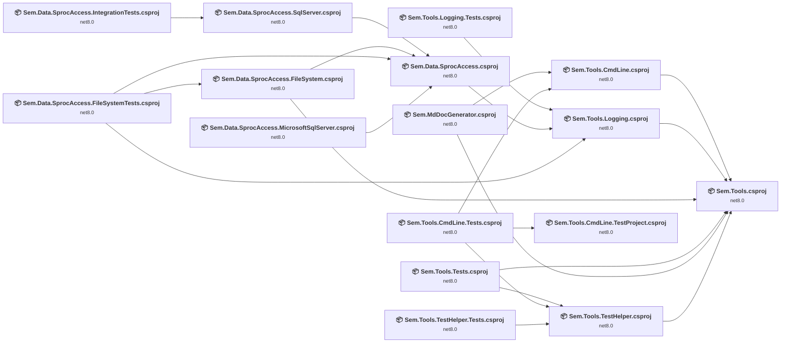

## Project Details

### Sem.Data.SprocAccess.FileSystem\Sem.Data.SprocAccess.FileSystem.csproj

#### Project Info

- **Current Target Framework:** net8.0
- **Proposed Target Framework:** net10.0
- **SDK-style**: True
- **Project Kind:** ClassLibrary
- **Dependencies**: 2
- **Dependants**: 1
- **Number of Files**: 3
- **Number of Files with Incidents**: 1
- **Lines of Code**: 206
- **Estimated LOC to modify**: 0+ (at least 0,0% of the project)

#### Dependency Graph

Legend:
📦 SDK-style project
⚙️ Classic project

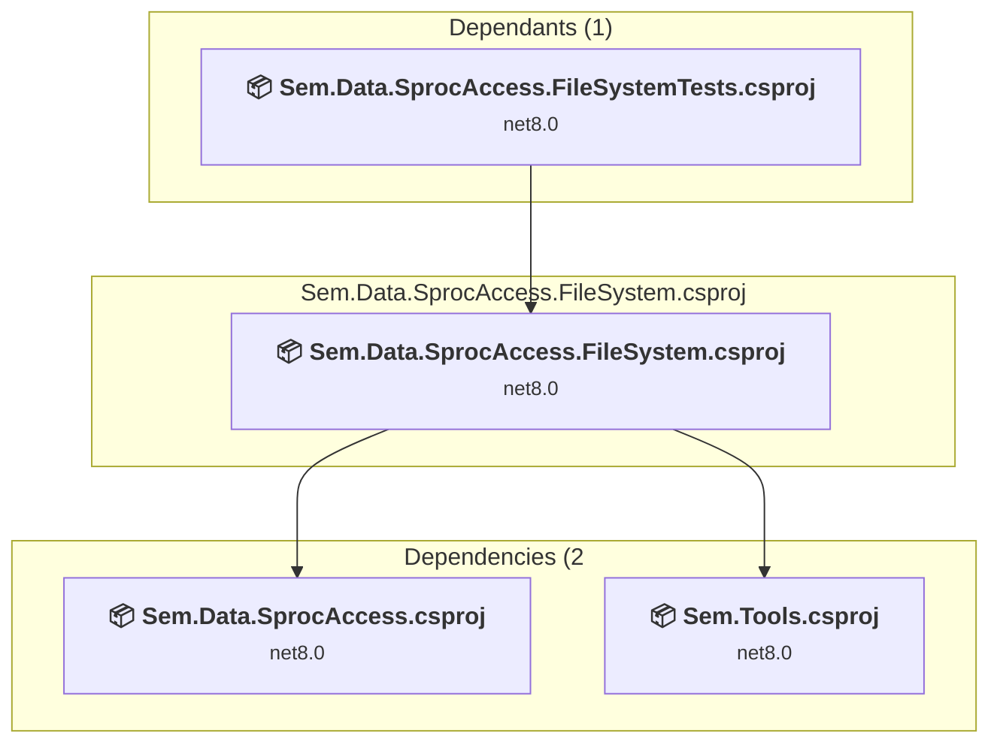

### API Compatibility

| Category | Count | Impact |
| :--- | :---: | :--- |
| 🔴 Binary Incompatible | 0 | High - Require code changes |
| 🟡 Source Incompatible | 0 | Medium - Needs re-compilation and potential conflicting API error fixing |
| 🔵 Behavioral change | 0 | Low - Behavioral changes that may require testing at runtime |
| ✅ Compatible | 154 |  |
| ***Total APIs Analyzed*** | ***154*** |  |

### Sem.Data.SprocAccess.FileSystemTests\Sem.Data.SprocAccess.FileSystemTests.csproj

#### Project Info

- **Current Target Framework:** net8.0
- **Proposed Target Framework:** net10.0
- **SDK-style**: True
- **Project Kind:** DotNetCoreApp
- **Dependencies**: 3
- **Dependants**: 0
- **Number of Files**: 7
- **Number of Files with Incidents**: 1
- **Lines of Code**: 235
- **Estimated LOC to modify**: 0+ (at least 0,0% of the project)

#### Dependency Graph

Legend:
📦 SDK-style project
⚙️ Classic project

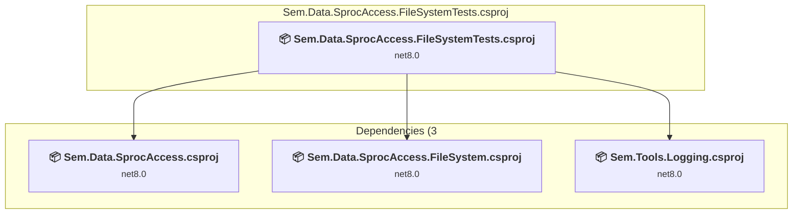

### API Compatibility

| Category | Count | Impact |
| :--- | :---: | :--- |
| 🔴 Binary Incompatible | 0 | High - Require code changes |
| 🟡 Source Incompatible | 0 | Medium - Needs re-compilation and potential conflicting API error fixing |
| 🔵 Behavioral change | 0 | Low - Behavioral changes that may require testing at runtime |
| ✅ Compatible | 24 |  |
| ***Total APIs Analyzed*** | ***24*** |  |

### Sem.Data.SprocAccess.IntegrationTests\Sem.Data.SprocAccess.IntegrationTests.csproj

#### Project Info

- **Current Target Framework:** net8.0
- **Proposed Target Framework:** net10.0
- **SDK-style**: True
- **Project Kind:** DotNetCoreApp
- **Dependencies**: 1
- **Dependants**: 0
- **Number of Files**: 3
- **Number of Files with Incidents**: 2
- **Lines of Code**: 134
- **Estimated LOC to modify**: 1+ (at least 0,7% of the project)

#### Dependency Graph

Legend:
📦 SDK-style project
⚙️ Classic project

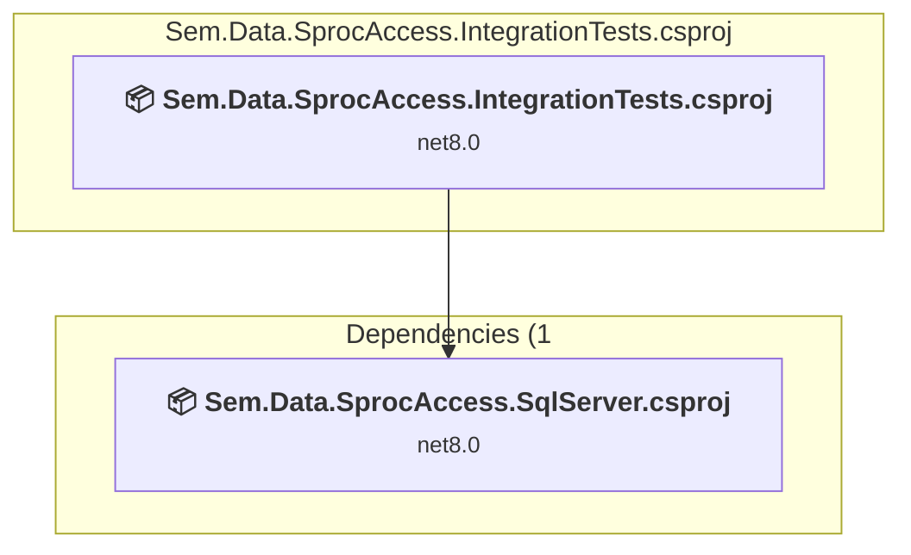

### API Compatibility

| Category | Count | Impact |
| :--- | :---: | :--- |
| 🔴 Binary Incompatible | 1 | High - Require code changes |
| 🟡 Source Incompatible | 0 | Medium - Needs re-compilation and potential conflicting API error fixing |
| 🔵 Behavioral change | 0 | Low - Behavioral changes that may require testing at runtime |
| ✅ Compatible | 68 |  |
| ***Total APIs Analyzed*** | ***69*** |  |

### Sem.Data.SprocAccess.MicrosoftSqlServer\Sem.Data.SprocAccess.MicrosoftSqlServer.csproj

#### Project Info

- **Current Target Framework:** net8.0
- **Proposed Target Framework:** net10.0
- **SDK-style**: True
- **Project Kind:** ClassLibrary
- **Dependencies**: 1
- **Dependants**: 0
- **Number of Files**: 3
- **Number of Files with Incidents**: 1
- **Lines of Code**: 215
- **Estimated LOC to modify**: 0+ (at least 0,0% of the project)

#### Dependency Graph

Legend:
📦 SDK-style project
⚙️ Classic project

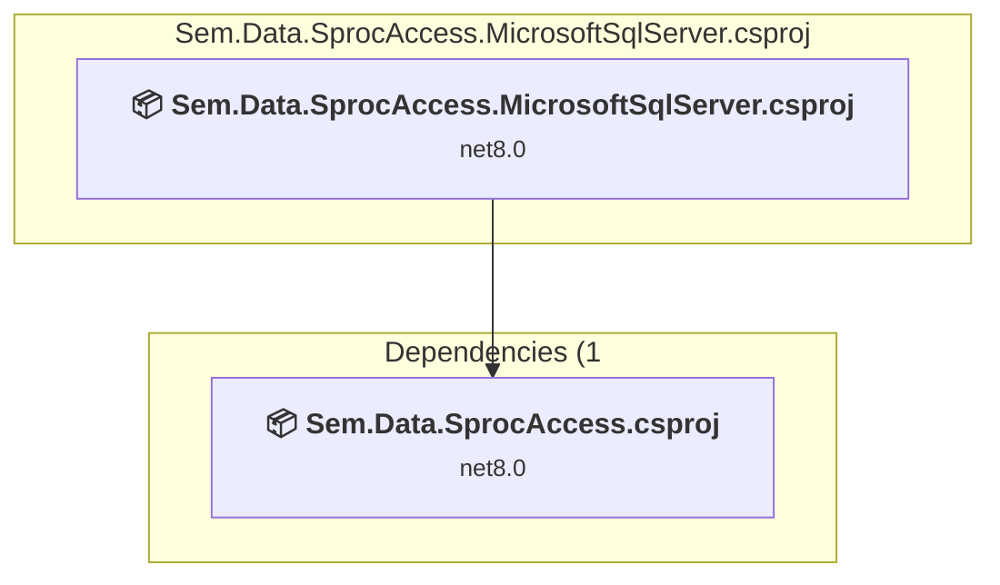

### API Compatibility

| Category | Count | Impact |
| :--- | :---: | :--- |
| 🔴 Binary Incompatible | 0 | High - Require code changes |
| 🟡 Source Incompatible | 0 | Medium - Needs re-compilation and potential conflicting API error fixing |
| 🔵 Behavioral change | 0 | Low - Behavioral changes that may require testing at runtime |
| ✅ Compatible | 206 |  |
| ***Total APIs Analyzed*** | ***206*** |  |

### Sem.Data.SprocAccess.SqlServer\Sem.Data.SprocAccess.SqlServer.csproj

#### Project Info

- **Current Target Framework:** net8.0
- **Proposed Target Framework:** net10.0
- **SDK-style**: True
- **Project Kind:** ClassLibrary
- **Dependencies**: 1
- **Dependants**: 1
- **Number of Files**: 3
- **Number of Files with Incidents**: 3
- **Lines of Code**: 162
- **Estimated LOC to modify**: 24+ (at least 14,8% of the project)

#### Dependency Graph

Legend:
📦 SDK-style project
⚙️ Classic project

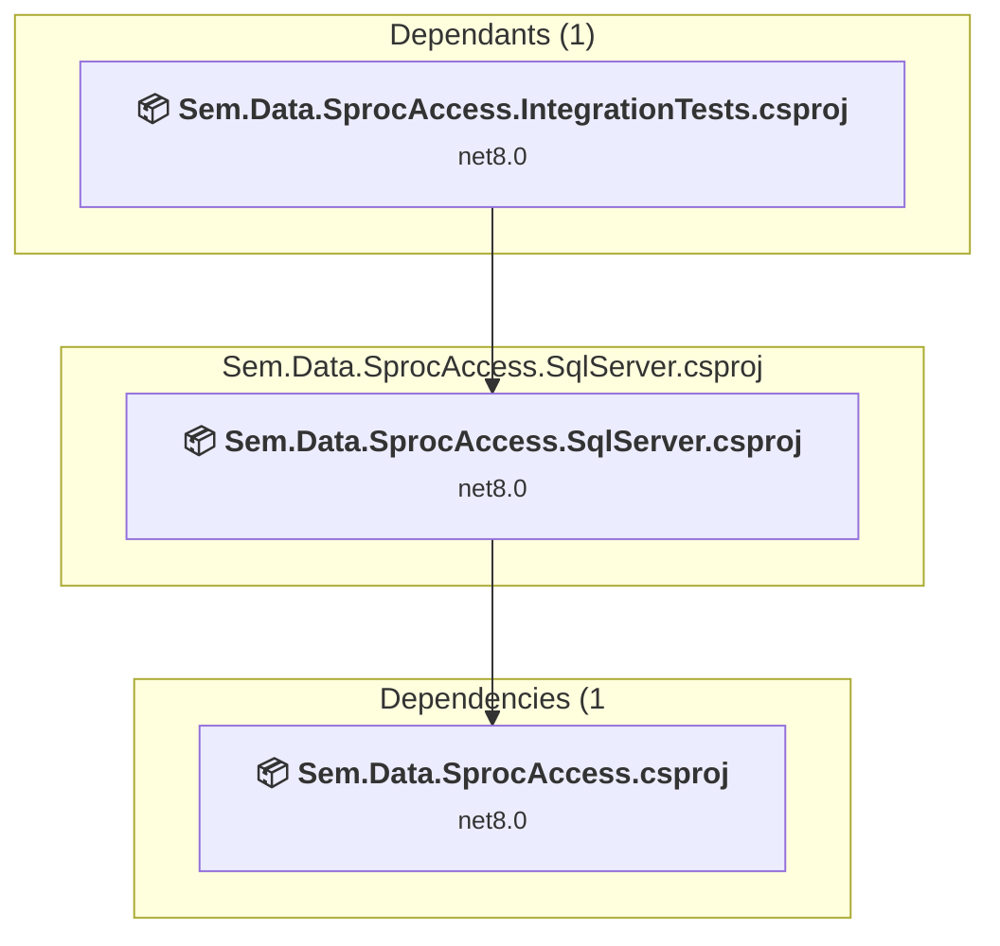

### API Compatibility

| Category | Count | Impact |
| :--- | :---: | :--- |
| 🔴 Binary Incompatible | 0 | High - Require code changes |
| 🟡 Source Incompatible | 24 | Medium - Needs re-compilation and potential conflicting API error fixing |
| 🔵 Behavioral change | 0 | Low - Behavioral changes that may require testing at runtime |
| ✅ Compatible | 102 |  |
| ***Total APIs Analyzed*** | ***126*** |  |

### Sem.Data.SprocAccess\Sem.Data.SprocAccess.csproj

#### Project Info

- **Current Target Framework:** net8.0
- **Proposed Target Framework:** net10.0
- **SDK-style**: True
- **Project Kind:** ClassLibrary
- **Dependencies**: 1
- **Dependants**: 4
- **Number of Files**: 3
- **Number of Files with Incidents**: 1
- **Lines of Code**: 92
- **Estimated LOC to modify**: 0+ (at least 0,0% of the project)

#### Dependency Graph

Legend:
📦 SDK-style project
⚙️ Classic project

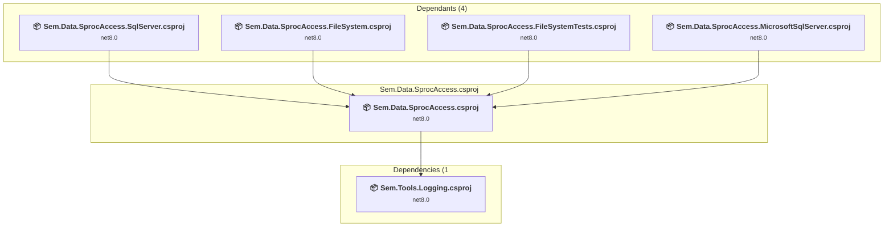

### API Compatibility

| Category | Count | Impact |
| :--- | :---: | :--- |
| 🔴 Binary Incompatible | 0 | High - Require code changes |
| 🟡 Source Incompatible | 0 | Medium - Needs re-compilation and potential conflicting API error fixing |
| 🔵 Behavioral change | 0 | Low - Behavioral changes that may require testing at runtime |
| ✅ Compatible | 21 |  |
| ***Total APIs Analyzed*** | ***21*** |  |

### Sem.MdDocGenerator\Sem.MdDocGenerator.csproj

#### Project Info

- **Current Target Framework:** net8.0
- **Proposed Target Framework:** net10.0
- **SDK-style**: True
- **Project Kind:** DotNetCoreApp
- **Dependencies**: 2
- **Dependants**: 0
- **Number of Files**: 21
- **Number of Files with Incidents**: 1
- **Lines of Code**: 904
- **Estimated LOC to modify**: 0+ (at least 0,0% of the project)

#### Dependency Graph

Legend:
📦 SDK-style project
⚙️ Classic project

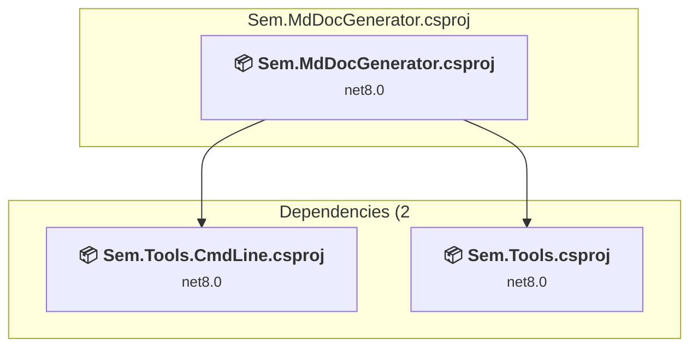

### API Compatibility

| Category | Count | Impact |
| :--- | :---: | :--- |
| 🔴 Binary Incompatible | 0 | High - Require code changes |
| 🟡 Source Incompatible | 0 | Medium - Needs re-compilation and potential conflicting API error fixing |
| 🔵 Behavioral change | 0 | Low - Behavioral changes that may require testing at runtime |
| ✅ Compatible | 702 |  |
| ***Total APIs Analyzed*** | ***702*** |  |

### Sem.Tools.CmdLine.TestProject\Sem.Tools.CmdLine.TestProject.csproj

#### Project Info

- **Current Target Framework:** net8.0
- **Proposed Target Framework:** net10.0
- **SDK-style**: True
- **Project Kind:** ClassLibrary
- **Dependencies**: 0
- **Dependants**: 1
- **Number of Files**: 2
- **Number of Files with Incidents**: 1
- **Lines of Code**: 23
- **Estimated LOC to modify**: 0+ (at least 0,0% of the project)

#### Dependency Graph

Legend:
📦 SDK-style project
⚙️ Classic project

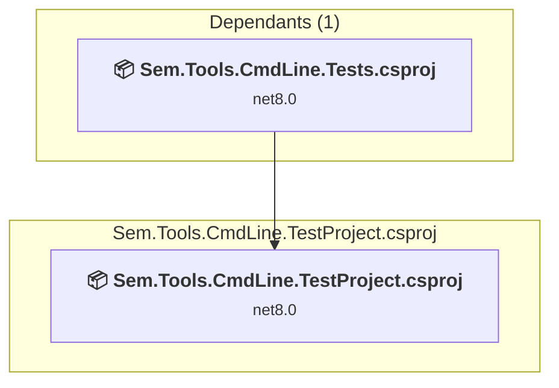

### API Compatibility

| Category | Count | Impact |
| :--- | :---: | :--- |
| 🔴 Binary Incompatible | 0 | High - Require code changes |
| 🟡 Source Incompatible | 0 | Medium - Needs re-compilation and potential conflicting API error fixing |
| 🔵 Behavioral change | 0 | Low - Behavioral changes that may require testing at runtime |
| ✅ Compatible | 3 |  |
| ***Total APIs Analyzed*** | ***3*** |  |

### Sem.Tools.CmdLine.Tests\Sem.Tools.CmdLine.Tests.csproj

#### Project Info

- **Current Target Framework:** net8.0
- **Proposed Target Framework:** net10.0
- **SDK-style**: True
- **Project Kind:** DotNetCoreApp
- **Dependencies**: 3
- **Dependants**: 0
- **Number of Files**: 15
- **Number of Files with Incidents**: 1
- **Lines of Code**: 923
- **Estimated LOC to modify**: 0+ (at least 0,0% of the project)

#### Dependency Graph

Legend:
📦 SDK-style project
⚙️ Classic project

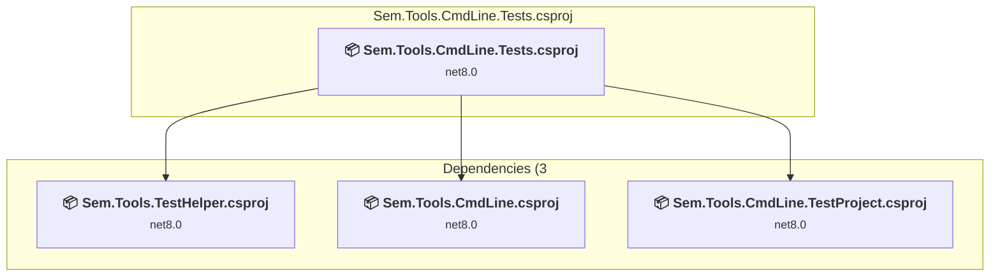

### API Compatibility

| Category | Count | Impact |
| :--- | :---: | :--- |
| 🔴 Binary Incompatible | 0 | High - Require code changes |
| 🟡 Source Incompatible | 0 | Medium - Needs re-compilation and potential conflicting API error fixing |
| 🔵 Behavioral change | 0 | Low - Behavioral changes that may require testing at runtime |
| ✅ Compatible | 146 |  |
| ***Total APIs Analyzed*** | ***146*** |  |

### Sem.Tools.CmdLine\Sem.Tools.CmdLine.csproj

#### Project Info

- **Current Target Framework:** net8.0
- **Proposed Target Framework:** net10.0
- **SDK-style**: True
- **Project Kind:** ClassLibrary
- **Dependencies**: 1
- **Dependants**: 2
- **Number of Files**: 4
- **Number of Files with Incidents**: 1
- **Lines of Code**: 786
- **Estimated LOC to modify**: 0+ (at least 0,0% of the project)

#### Dependency Graph

Legend:
📦 SDK-style project
⚙️ Classic project

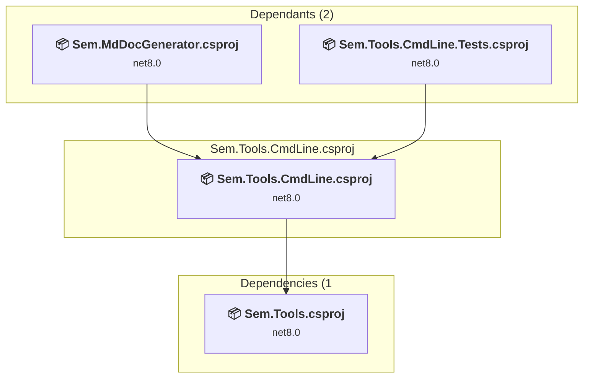

### API Compatibility

| Category | Count | Impact |
| :--- | :---: | :--- |
| 🔴 Binary Incompatible | 0 | High - Require code changes |
| 🟡 Source Incompatible | 0 | Medium - Needs re-compilation and potential conflicting API error fixing |
| 🔵 Behavioral change | 0 | Low - Behavioral changes that may require testing at runtime |
| ✅ Compatible | 682 |  |
| ***Total APIs Analyzed*** | ***682*** |  |

### Sem.Tools.Logging.Tests\Sem.Tools.Logging.Tests.csproj

#### Project Info

- **Current Target Framework:** net8.0
- **Proposed Target Framework:** net10.0
- **SDK-style**: True
- **Project Kind:** DotNetCoreApp
- **Dependencies**: 1
- **Dependants**: 0
- **Number of Files**: 5
- **Number of Files with Incidents**: 1
- **Lines of Code**: 482
- **Estimated LOC to modify**: 0+ (at least 0,0% of the project)

#### Dependency Graph

Legend:
📦 SDK-style project
⚙️ Classic project

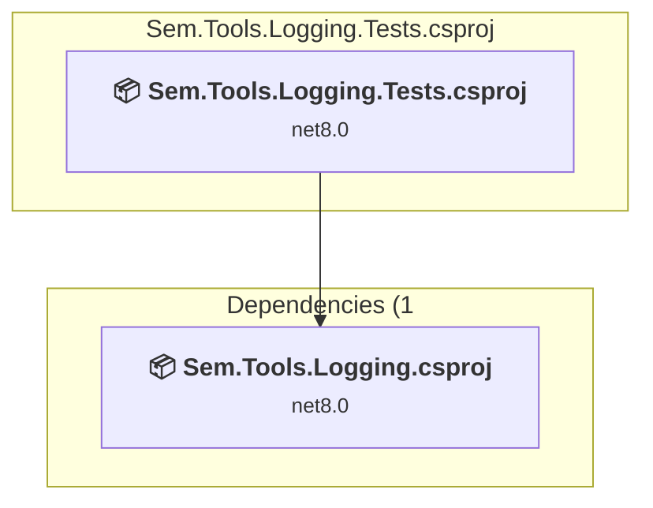

### API Compatibility

| Category | Count | Impact |
| :--- | :---: | :--- |
| 🔴 Binary Incompatible | 0 | High - Require code changes |
| 🟡 Source Incompatible | 0 | Medium - Needs re-compilation and potential conflicting API error fixing |
| 🔵 Behavioral change | 0 | Low - Behavioral changes that may require testing at runtime |
| ✅ Compatible | 43 |  |
| ***Total APIs Analyzed*** | ***43*** |  |

### Sem.Tools.Logging\Sem.Tools.Logging.csproj

#### Project Info

- **Current Target Framework:** net8.0
- **Proposed Target Framework:** net10.0
- **SDK-style**: True
- **Project Kind:** ClassLibrary
- **Dependencies**: 1
- **Dependants**: 3
- **Number of Files**: 5
- **Number of Files with Incidents**: 1
- **Lines of Code**: 335
- **Estimated LOC to modify**: 0+ (at least 0,0% of the project)

#### Dependency Graph

Legend:
📦 SDK-style project
⚙️ Classic project

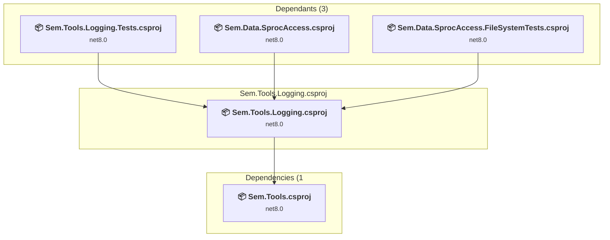

### API Compatibility

| Category | Count | Impact |
| :--- | :---: | :--- |
| 🔴 Binary Incompatible | 0 | High - Require code changes |
| 🟡 Source Incompatible | 0 | Medium - Needs re-compilation and potential conflicting API error fixing |
| 🔵 Behavioral change | 0 | Low - Behavioral changes that may require testing at runtime |
| ✅ Compatible | 213 |  |
| ***Total APIs Analyzed*** | ***213*** |  |

### Sem.Tools.TestHelper.Tests\Sem.Tools.TestHelper.Tests.csproj

#### Project Info

- **Current Target Framework:** net8.0
- **Proposed Target Framework:** net10.0
- **SDK-style**: True
- **Project Kind:** DotNetCoreApp
- **Dependencies**: 1
- **Dependants**: 0
- **Number of Files**: 4
- **Number of Files with Incidents**: 1
- **Lines of Code**: 119
- **Estimated LOC to modify**: 0+ (at least 0,0% of the project)

#### Dependency Graph

Legend:
📦 SDK-style project
⚙️ Classic project

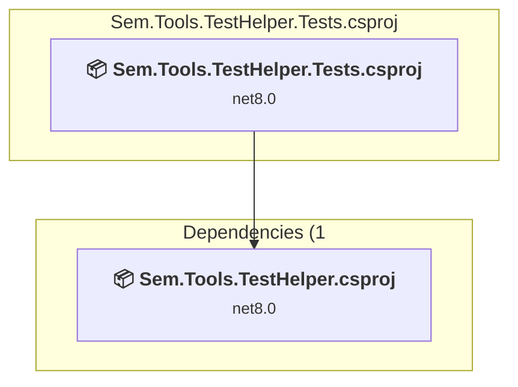

### API Compatibility

| Category | Count | Impact |
| :--- | :---: | :--- |
| 🔴 Binary Incompatible | 0 | High - Require code changes |
| 🟡 Source Incompatible | 0 | Medium - Needs re-compilation and potential conflicting API error fixing |
| 🔵 Behavioral change | 0 | Low - Behavioral changes that may require testing at runtime |
| ✅ Compatible | 2 |  |
| ***Total APIs Analyzed*** | ***2*** |  |

### Sem.Tools.TestHelper\Sem.Tools.TestHelper.csproj

#### Project Info

- **Current Target Framework:** net8.0
- **Proposed Target Framework:** net10.0
- **SDK-style**: True
- **Project Kind:** ClassLibrary
- **Dependencies**: 1
- **Dependants**: 3
- **Number of Files**: 3
- **Number of Files with Incidents**: 1
- **Lines of Code**: 202
- **Estimated LOC to modify**: 0+ (at least 0,0% of the project)

#### Dependency Graph

Legend:
📦 SDK-style project
⚙️ Classic project

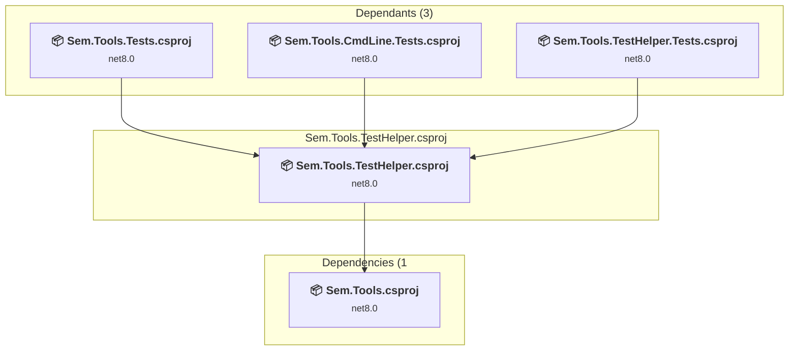

### API Compatibility

| Category | Count | Impact |
| :--- | :---: | :--- |
| 🔴 Binary Incompatible | 0 | High - Require code changes |
| 🟡 Source Incompatible | 0 | Medium - Needs re-compilation and potential conflicting API error fixing |
| 🔵 Behavioral change | 0 | Low - Behavioral changes that may require testing at runtime |
| ✅ Compatible | 170 |  |
| ***Total APIs Analyzed*** | ***170*** |  |

### Sem.Tools.Tests\Sem.Tools.Tests.csproj

#### Project Info

- **Current Target Framework:** net8.0
- **Proposed Target Framework:** net10.0
- **SDK-style**: True
- **Project Kind:** DotNetCoreApp
- **Dependencies**: 2
- **Dependants**: 0
- **Number of Files**: 11
- **Number of Files with Incidents**: 1
- **Lines of Code**: 633
- **Estimated LOC to modify**: 0+ (at least 0,0% of the project)

#### Dependency Graph

Legend:
📦 SDK-style project
⚙️ Classic project

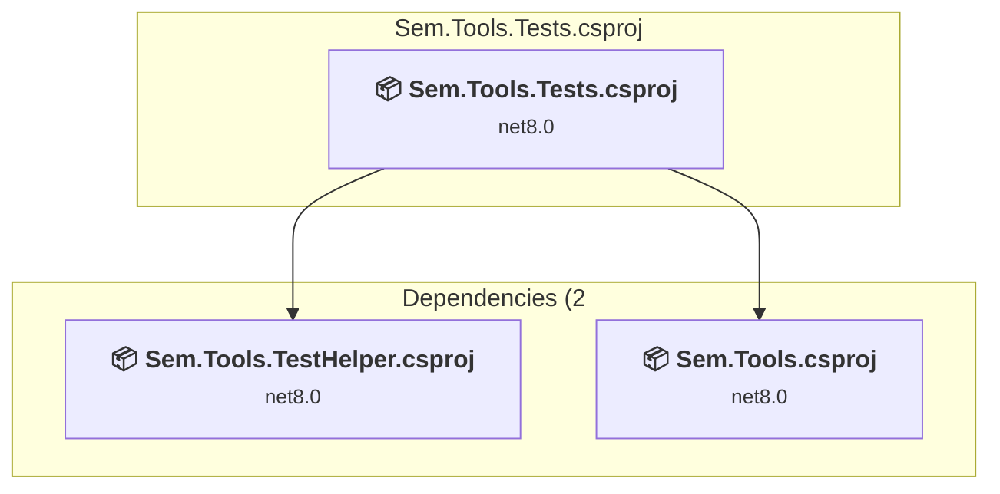

### API Compatibility

| Category | Count | Impact |
| :--- | :---: | :--- |
| 🔴 Binary Incompatible | 0 | High - Require code changes |
| 🟡 Source Incompatible | 0 | Medium - Needs re-compilation and potential conflicting API error fixing |
| 🔵 Behavioral change | 0 | Low - Behavioral changes that may require testing at runtime |
| ✅ Compatible | 19 |  |
| ***Total APIs Analyzed*** | ***19*** |  |

### Sem.Tools\Sem.Tools.csproj

#### Project Info

- **Current Target Framework:** net8.0
- **Proposed Target Framework:** net10.0
- **SDK-style**: True
- **Project Kind:** ClassLibrary
- **Dependencies**: 0
- **Dependants**: 6
- **Number of Files**: 9
- **Number of Files with Incidents**: 3
- **Lines of Code**: 521
- **Estimated LOC to modify**: 12+ (at least 2,3% of the project)

#### Dependency Graph

Legend:
📦 SDK-style project
⚙️ Classic project

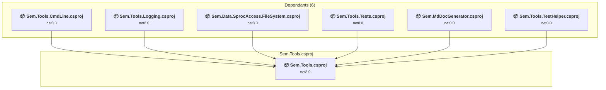

### API Compatibility

| Category | Count | Impact |
| :--- | :---: | :--- |
| 🔴 Binary Incompatible | 0 | High - Require code changes |
| 🟡 Source Incompatible | 10 | Medium - Needs re-compilation and potential conflicting API error fixing |
| 🔵 Behavioral change | 2 | Low - Behavioral changes that may require testing at runtime |
| ✅ Compatible | 328 |  |
| ***Total APIs Analyzed*** | ***340*** |  |

